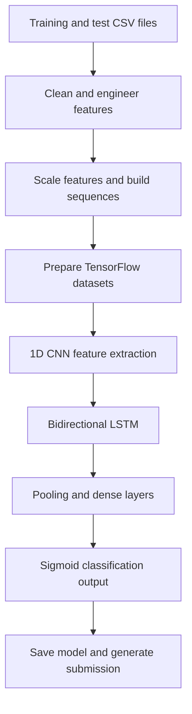

<div align="center">

# Stock Trend Classifier

**Deep-learning classification of stock-market trends using a hybrid 1D CNN–Bidirectional LSTM network.**


</div>

## Overview

**Stock Trend Classifier** is a modular Python machine-learning project for learning stock-market trend patterns from historical tabular time-series data. It combines **convolutional feature extraction** with **bidirectional recurrent sequence modeling** and produces predictions in a competition-style submission format.

The repository organizes data preparation, feature engineering, training, model definition, and inference into separate modules. Its entry point is `main.py`.

> **Scope:** This is a classification pipeline—not an automated trading system or a guarantee of future market performance. The repository does not publish independently verified performance metrics in its current README.

## Features

- **Hybrid CNN–BiLSTM:** 1D convolutions extract local sequence patterns; bidirectional LSTM layers model temporal context.
- **Time-series preprocessing:** Cleaning, feature engineering, scaling, and sequence preparation.
- **Ticker-aware dataset handling:** Modules for ticker-based splitting and TensorFlow sequence datasets.
- **Focal loss:** A binary classification objective that down-weights well-classified examples.
- **Training metrics:** Accuracy, precision, recall, ROC AUC, and PR AUC.
- **Configurable execution:** Set input directory and training epochs from the command line.
- **Reproducible outputs:** Save a Keras model artifact and a CSV submission.
- **Modular project layout:** Separate configuration, input/output, preprocessing, datasets, model, and pipeline logic.

## Technology Stack

| Area | Tools |
| --- | --- |
| Language | Python |
| Neural network | TensorFlow / Keras |
| Data processing | NumPy, pandas |
| Machine learning utilities | scikit-learn |
| Visualization dependencies | Matplotlib, Seaborn |
| Model architecture | 1D CNN + Bidirectional LSTM |
| Training objective | Binary focal loss |

## Architecture

The model defined in `src/stock_trend/model.py` uses the following components:

1. Two `Conv1D(64)` layers with batch normalization.
2. Max pooling and spatial dropout.
3. Two `Conv1D(128)` layers with batch normalization and spatial dropout.
4. A `Bidirectional(LSTM(64))` sequence layer.
5. Global average pooling, a 128-unit dense layer, and dropout.
6. A **single sigmoid output** for binary classification.

The model is compiled with the Adam optimizer and a focal-loss objective. Its implementation also tracks classification and ranking-related metrics.



## Project Structure

```text
Stock-Trend-Classifier/
├── main.py                     # Command-line entry point
├── requirements.txt            # Python dependencies
├── src/
│   └── stock_trend/
│       ├── config.py           # Paths and training parameters
│       ├── data.py             # CSV input and submission output
│       ├── preprocessing.py    # Cleaning, features, scaling, sequences
│       ├── datasets.py         # Ticker splits and TensorFlow datasets
│       ├── model.py            # CNN–BiLSTM and focal loss
│       └── pipeline.py         # Training and prediction orchestration
├── data/                       # Create locally; provide dataset files
│   ├── train.csv
│   ├── test.csv
│   └── sample_submission.csv
├── artifacts/                  # Generated model artifacts
│   └── best_model.keras
└── outputs/                    # Generated prediction files
    └── submission.csv
```

The `data/`, `artifacts/`, and `outputs/` entries show the expected input and generated-output layout; some may not exist until the user supplies data or runs the pipeline.

## Getting Started

### 1. Prerequisites

- Python and `pip` in an environment compatible with the versions of TensorFlow and other installed packages.
- Training, testing, and sample-submission CSV files matching the pipeline's expected schema.
- A Python virtual environment is recommended. A compatible GPU may accelerate model training but is not required by the documented command line.

### 2. Clone the repository

```bash
git clone https://github.com/MohammedAbdelkarem/Stock-Trend-Classifier.git
cd Stock-Trend-Classifier
```

### 3. Create an environment and install dependencies

```bash
python -m venv .venv
```

On Linux/macOS:

```bash
source .venv/bin/activate
```

On Windows PowerShell:

```powershell
.venv\Scripts\Activate.ps1
```

Then install dependencies:

```bash
pip install -r requirements.txt
```

### 4. Prepare your data

Place the competition-provided files in `data/`:

```text
data/
├── train.csv
├── test.csv
└── sample_submission.csv
```

The training data is **not fetched automatically** by the instructions in the repository's current README. Dataset column requirements are determined by the preprocessing and data-loading code.

### 5. Run training and prediction

The project uses a `src/` layout, so include that directory in Python's module search path.

Linux/macOS:

```bash
PYTHONPATH=src python main.py
```

Windows PowerShell:

```powershell
$env:PYTHONPATH = "src"
python main.py
```

Override the input location or number of training epochs:

```bash
PYTHONPATH=src python main.py --data-dir /path/to/data --epochs 20
```

The CLI exposes `--data-dir` and `--epochs`; additional training parameters are defined in `ProjectConfig`.

## Default Configuration

Default values from `src/stock_trend/config.py`:

| Parameter | Default | Role |
| --- | ---: | --- |
| `lookback` | 30 | Input sequence length |
| `horizon` | 30 | Prediction horizon setting |
| `validation_ratio` | 0.20 | Validation split proportion |
| `batch_size` | 128 | Batch size |
| `epochs` | 30 | Number of epochs |
| `steps_per_epoch` | 2000 | Training steps per epoch |
| `validation_steps` | 400 | Validation steps |
| `threshold` | 0.5 | Classification threshold setting |

These values describe configuration defaults, **not benchmark results or recommended financial-trading settings**.

## Outputs

Successful execution is configured to produce:

| Path | Description |
| --- | --- |
| `artifacts/best_model.keras` | Saved Keras model artifact |
| `outputs/submission.csv` | Competition-style prediction submission |

The exact submission columns depend on the supplied `sample_submission.csv` and the output-writing logic.

## Machine Learning Notes

### Why combine CNN and BiLSTM?

A **1D CNN** learns local patterns from the feature sequences, while a **Bidirectional LSTM** learns relationships across the sequence. Their combination supports classification from engineered stock time-series data; predictive quality must still be assessed empirically on appropriate out-of-sample data.

### Why focal loss?

Focal loss places greater emphasis on difficult examples than standard binary cross-entropy. This may be useful when examples differ in difficulty or class representation, but the benefit must be established with validation experiments.

### Evaluation considerations

For credible financial time-series experiments, avoid leakage from future observations and report time-aware validation results, class distributions, and baseline comparisons. The model's available metric definitions should not be confused with measured performance.

## Potential Improvements

- Publish dataset schema and a small non-sensitive sample.
- Document the exact target definition and prediction horizon semantics.
- Include validated accuracy, precision, recall, ROC AUC, PR AUC, and confusion matrices.
- Compare the hybrid network with simple baselines and ablation variants.
- Add automated tests for feature engineering, splits, sequence construction, and inference.
- Provide pinned dependency versions and a reproducible environment.
- Add experiment tracking, model versioning, and time-aware backtesting.

## Authors

Developed by:

- **[Alaa Daloo](https://github.com/AlaaDaloo)**
- **[Mohammed Abdelkarem](https://github.com/MohammedAbdelkarem)**

## Disclaimer

**For research and educational use.** Financial markets are inherently uncertain; model predictions are not investment advice and should not be relied on as a stand-alone trading signal.

## License

No license terms are asserted here. Consult the repository for any subsequently added license before redistributing or reusing its code.

---

<div align="center">
  <em>Exploring temporal patterns in financial data through deep-learning classification.</em>
</div>
